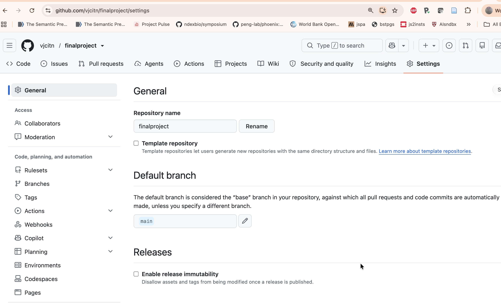
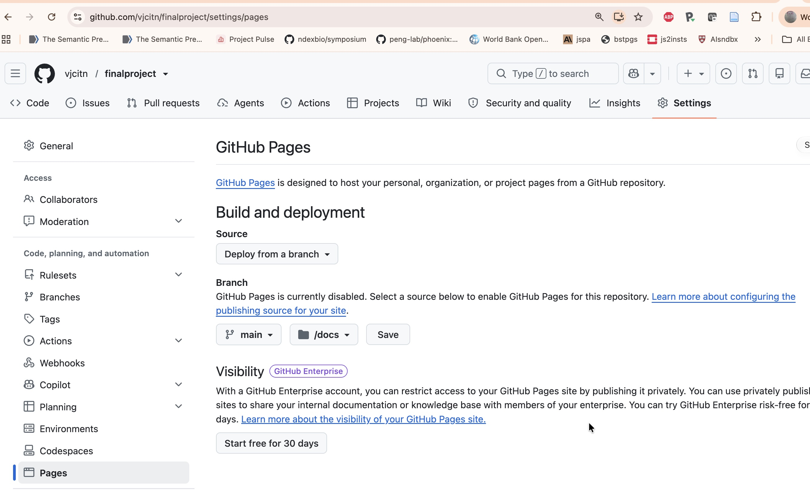

# Introduction

The instructions indicate that your project should include description
and analysis of two or more datasets of interest to you.

You will be working in the context of an R package, based on your
fork of vjcitn/bst260project-template from github.com

Your R package will be defined to create a public web page using the
pkgdown R package capabilities.

This document is provided to give you some ideas on how you can complete
the project tasks.

# Verifying your approach

Once you have forked the bst260project-template, you must

- rename the repository to "finalproject"
- make the repository public
- set the Pages configuration to publish from /docs on main branch (see images at the bottom of
this document)
- change the DESCRIPTION file to reflect facts about your GitHub identity and site URL

# Examples

In this section a few suggestions are made concerning directions that projects
might take.  

- You should be creative in your formulation of questions and you
should use data visualization tools and statistical summaries to make your points.
- You should write R functions that perform tasks repetitively on different
facets of the data.

## CDC food/waterborne illness data

There are many avenues to explore.

- Data science considerations
    - The data are provided as a list, and there are different numbers of 
event features recorded per event.  How can you make it a tidy data resource,
and what are the benefits of doing so?
    - Add value to the data by converting the fragmentary event date information
to `Date` objects
    - Learn about the "ifsac categorization" of disease events and explain its
role in the enumeration and interpretation of outbreaks
- Statistical considerations
    - States and months are the primary coordinates for locating events in
space and time.  Latitude and longitude can be obtained from datasets::state.center;
region labels are available in state.region and state.division.  Form intepretable expected
event counts, and compare to observed values, for 
        - different types of outbreaks in different regions
        - types of outcomes in different decades
    - Try your hand and making statistical maps of event locations using the leaflet package

## CDC Firearm Mortality and RAND Gun Legislation Database

## CDC Homicide Mortality

## NCHS Birth Database

See the package [in development](https://vjcitn.github.io/nchsNatality)
  

## NHANES

The options here are from 2025, but the product is not a set of written documents
but a working web site.  The content for this dataset can address any of these options:

### Option 1: Age-Specific Health Analysis
Focus on one of these age groups with appropriate health outcomes:

- Ages 2-18: Growth patterns, childhood health indicators (note: different BMI/growth relationships than adults)
- Ages 19-40: Young adult health patterns, lifestyle factors
- Ages 40+: Disease risk factors, aging-related health patterns

Key considerations: Include important covariates (age, sex, race) and their interactions. Consult relevant literature for risk factors specific to your chosen age group and outcome.

### Option 2: Statistical Methodology Focus
Instead of focusing on specific health outcomes, examine statistical approaches:

- Multiple imputation methods for handling missing data patterns
- Spline models for interpretable non-linear associations with continuous variables
- Survey methods for population-level estimates and inference
- Machine learning approaches (logistic regression, random forests) for data structure exploration
- Interactive applications using Shiny/Posit Connect for data exploration tools

### Option 3: Missing Data Analysis
Investigate missing data patterns in NHANES:

- Understand why observations are missing for different variables
- Apply modern missing data methods
- Compare analytical approaches under different missingness assumptions

### Option 4: Custom Research Question

Propose your own research question using NHANES data, subject to TF approval. Must demonstrate clear analytical approach and feasibility.

### Important Data Considerations

- Missing Values: Many NHANES variables have substantial missing data. Consider whether this affects your analysis or could be the focus of your study.

- Outcome Variables: Examples include systolic blood pressure, diabetes risk, depression scores, sleep patterns, smoking status, BMI. Continuous outcomes may be easier to model initially.

# Images for GitHub pages setup

